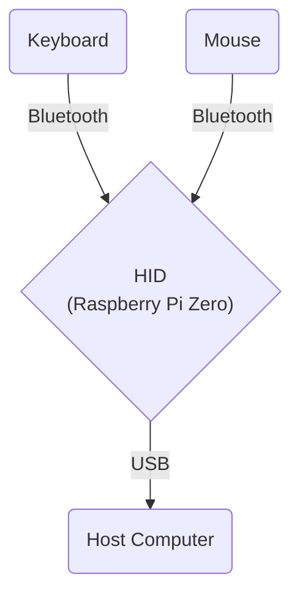

# Bluetooth USB HID Relay

### A delightfully over-engineered solution to an unusual modern problem!

Use Bluetooth peripherals with Bluetooth-disabled computers.


This project creates a Bluetooth USB HID relay using a Raspberry Pi Zero (or similar single-board computer whose USB port can run in USB device/gadget mode toward your PC). It allows you to use Bluetooth keyboards and mice with computers that have Bluetooth disabled, by presenting the board as a composite USB HID device. The USB cable from the board to that computer must be data-capable (not charge-only), so the host can enumerate the gadget.

## Inspiration

This project was born out of a desire to help a friend who couldn't use his favorite Bluetooth mouse and keyboard due to Bluetooth being disabled on his work laptop. As someone who enjoys tinkering and problem-solving, I saw this as an opportunity to create something useful while learning more about Linux internals, USB gadgets, and Go programming. The Raspberry Pi Zero became the perfect bridge, connecting Bluetooth peripherals to computers that wouldn't normally allow it.



## Features

- Connects to Bluetooth keyboards and mice
- Presents itself as a composite USB HID device (keyboard and mouse) to the host computer
- Works with Windows, Mac, and Linux computers
- Automatically starts the relay service at boot
- Configures the board as a USB gadget (composite HID) toward the host PC
- Includes a script to help pair Bluetooth devices

## Components

- Raspberry Pi Zero or other SBC with a USB port wired for gadget mode to the host PC
- DietPi or another lightweight Linux distribution
- Bash scripts for setup and configuration
- Go program for handling Bluetooth input and USB HID output
- Systemd service for automatic startup

## Requirements & Compatibility

### Hardware

- **Tested on:** Raspberry Pi Zero W 2
- **Should work on:** SBCs where Linux can use a USB port as a gadget toward another machine (ordinary host-only Type-A ports are not enough without extra hardware).
- **Requirements:** Data-capable cable to the host; kernel and controller support for configfs/libcomposite on that link.
- **Which port:** Pi Zero / Zero 2 W: two micro-USB jacks—run the PC link on the one labeled USB (PWR is power-only for this). Other boards: use the connector documented for USB device or gadget mode.

### Software Prerequisites

Before building and running the project, ensure you have the following installed:

1. Go (version 1.21 or later)

   On most Linux distributions, including Raspberry Pi OS (formerly Raspbian), you can install Go using:

   ```bash
   sudo apt-get update
   sudo apt-get install golang
   ```

2. Task runner using:

   ```bash
   sh -c "$(curl --location https://taskfile.dev/install.sh)" -- -d -b ~/.local/bin
   ```

   or

   ```bash
   go install github.com/go-task/task/v3/cmd/task@latest
   ```

   > Note: You may need to add $(go env GOPATH)/bin to your PATH environment variable with the second command.

## ⚠️ Note on Setup

**Please read before proceeding:**

This project has been tested and works well on the Raspberry Pi Zero W 2, though it's still in development. While the setup process is straightforward, please note:

- The setup scripts will modify some Raspberry Pi system configurations (USB and Bluetooth settings)
- If something goes wrong during USB gadget setup, you may need to reflash your Raspberry Pi's OS
- The project has been tested primarily on Raspberry Pi Zero W 2 with DietPi OS
- This is a community project built for learning and experimentation

**Before running this project:**

- Make sure you have a backup of your Raspberry Pi's SD card if needed
- Review the scripts to understand what system changes will be made
- Be familiar with basic Raspberry Pi administration
- Have a way to reflash your SD card if necessary

While the setup process is generally safe, please proceed thoughtfully and feel free to ask questions if you're unsure about any step.

## Setup

1. Log in to your Raspberry Pi Zero.
2. Clone this repository to your board.
3. Run the setup scripts in order: `setup_usb_gadget.sh` enables peripheral USB at boot; reboot; then `setup_hid_composite.sh` defines the composite HID in configfs.

   ```bash
   sudo chmod +x scripts/*.sh # make sure all scripts are executable
   sudo ./scripts/setup_usb_gadget.sh # boot + modules: dwc2 peripheral mode, dwc2 and libcomposite
   sudo reboot
   sudo ./scripts/setup_bluetooth.sh # enable and start the bluetooth service
   sudo ./scripts/setup_hid_composite.sh # configfs: composite HID gadget (USB strings, functions, UDC)
   ```

4. Pair your Bluetooth devices manually or using the script:

   ```bash
   sudo ./scripts/pair_devices.sh
   ```

5. Build and install the service:
   ```bash
   task build
   sudo task service:install
   ```

## Usage

Plug the board into the PC with a data cable on the gadget port (Pi Zero: USB socket, not PWR; charge-only cables will not enumerate). On boot the installed service starts; paired Bluetooth devices should attach and the service retries if not. Windows and macOS have been tested.

## Tasks

This project uses Task runner for common operations:

### General tasks

- `task --list` - List all available tasks
- `task build` - Build the project
- `task clean` - Clean build artifacts
- `task test` - Run tests
- `task run` - Build and run the application
- `task doctor` - Run the diagnose tool
- `task simulate` - Run the simulate tool

### Service Management

- `task service:install` - Install and enable the service
- `task service:status` - Check service status
- `task service:logs` - View service logs
- `task service:restart` - Restart the service
- `task service:start` - Start the service
- `task service:stop` - Stop the service
- `task service:uninstall` - Remove the service

## Diagnostic Tools

### I/O Doctor

This tool will check for connected Bluetooth devices and display all incoming events from your Bluetooth keyboard and mouse, helping you debug connection and input issues.

```bash
task doctor
```

### Input Simulation

To test the USB HID output without Bluetooth devices:

```bash
task simulate
```

This interactive tool allows you to:

1. Move the mouse in a circle pattern
2. Type a test message
   These simulations help verify that the USB HID device is working correctly on the host computer.

### Uninstall and remove gadget

To uninstall the service:

```bash
task service:uninstall
```

To remove the configfs HID gadget and restore the USB peripheral boot configuration:

```bash
./scripts/uninstall/undo_setup_hid_composite.sh
./scripts/uninstall/undo_setup_usb_gadget.sh
```

## Development

This project can be used as is or as basis for other types of USB gadgets. It can also serve as a learning opportunity for:

- Linux internals
- Creating USB gadgets
- Using Go for hardware interfacing
- Setting up systemd services
- Configuring single-board computers as USB gadgets (device mode)
- Bluetooth device pairing and management

It's been a fun journey of discovery, and I hope others find it useful or inspiring for their own projects!

## Compatibility

Tested with DietPi 64bit as host and Windows 10 and MacOS USB clients to which the keyboard and mouse were connected. No issues with latency or input delay. My friend have been using this setup for a few days now and it works great.

## Issues and Support

Found a bug or have a suggestion? Please feel free to create an issue on GitHub! I'm actively maintaining this project and would be happy to look into any problems or improvements you identify. While this is a personal project, I'm committed to helping others get it working and making it better.

Your feedback and contributions help make this project more reliable for everyone! 💜

## References

- [Adafruit Guide: Turning your Raspberry Pi Zero into a USB Gadget](https://cdn-learn.adafruit.com/downloads/pdf/turning-your-raspberry-pi-zero-into-a-usb-gadget.pdf)
- [Composite USB Gadgets on the Raspberry Pi Zero](https://www.isticktoit.net/?p=1383)

## License

This project is licensed under the MIT License - see the [LICENSE](LICENSE) file for details.
